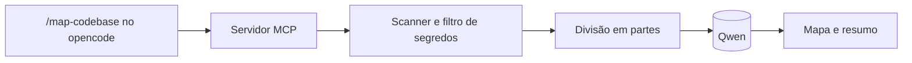

# project-mapper

Mapeador de código interno. Gera `docs/CODEBASE_MAP.md` com o modelo da própria empresa (qualquer servidor compatível com a API da OpenAI, como o Qwen) e é chamado de dentro do opencode por um servidor MCP.

Baseado no fluxo do [Cartographer](https://github.com/kingbootoshi/cartographer) (licença MIT, veja [THIRD_PARTY_NOTICES.md](THIRD_PARTY_NOTICES.md)).

## Como funciona



1. **Scan**: lista os arquivos com `git ls-files` (ou percorre as pastas, fora do git) e descarta binários, dependências e arquivos gerados.
2. **Divisão**: agrupa por pasta, respeitando o limite de tokens por requisição.
3. **Análise**: envia cada parte ao modelo, com concorrência limitada.
4. **Síntese**: gera visão geral, fluxos, convenções e guia de navegação.
5. **Escrita**: monta o mapa e atualiza o resumo nas instruções do projeto.

A orquestração é código comum, não o modelo. O resultado não depende da qualidade das chamadas de ferramenta do Qwen, e o conteúdo do repositório é analisado em chamadas sem ferramentas, então um texto malicioso num arquivo não consegue executar nada.

## Instalação

Requer Node 22.13 ou mais recente, que já traz o SQLite usado pelo grafo. Nada é compilado na instalação: o parser de Java roda em WebAssembly.

```bash
npm install
```

```bash
npm run build
```

No projeto que será mapeado (ou em `~/.config/opencode/`, para valer em todos):

1. Copie [opencode/commands/map-codebase.md](opencode/commands/map-codebase.md) para `.opencode/commands/`.
2. Junte [opencode/opencode.example.jsonc](opencode/opencode.example.jsonc) ao seu `opencode.json` e preencha o caminho e o servidor.

## Uso

No opencode:

```text
/map-codebase
/map-codebase --force
```

Fora do opencode, por exemplo em CI:

```bash
node dist/src/cli.js /caminho/do/projeto --dry-run
```

```bash
node dist/src/cli.js /caminho/do/projeto
```

O `--dry-run` mostra o que seria processado, sem chamar o modelo. Rodar de novo só reanalisa o que mudou, e não faz nenhuma chamada se nada mudou.

## Grafo de código

Além do mapa, o projeto extrai um grafo do código Java e o guarda em `.project-mapper/graph.sqlite`. O grafo **não usa o modelo**: é rápido, roda offline e o mesmo código sempre gera o mesmo grafo. Cada consulta atualiza o grafo antes de responder, relendo só os arquivos que mudaram.

| Ferramenta MCP | Pergunta que responde |
|---|---|
| `graph_search` | Onde está tal classe, método, endpoint ou tabela? |
| `graph_context` | Do que isso depende, e o que depende disso? |
| `graph_impact` | O que pode quebrar se eu mudar isso? Lista endpoints e testes afetados |
| `graph_path` | Como este código chega naquele, inclusive passando por outro serviço? |
| `graph_index` | Qual o tamanho e a cobertura do grafo? |

O alvo pode ser um nome (`UserService`), `Tipo#metodo`, um caminho de arquivo ou um endpoint (`GET /users`). Também dá para consultar pela CLI:

```bash
node dist/src/cli.js graph impact UserServiceImpl --root /caminho/do/projeto
```

**O que é extraído:** classes, interfaces, enums, records e métodos; herança, injeção (`@Autowired`, construtor, Lombok) e referências entre tipos; chamadas de método; endpoints do Spring MVC; tabelas JPA (`@Table`, `@JoinTable`); chamadas HTTP entre serviços via `RestTemplate` e `@FeignClient`, ligadas ao endpoint de destino por verbo e formato do caminho.

**O grafo também alimenta o mapa:** as seções "Service Dependencies" e "HTTP Endpoints" são escritas direto a partir dele, e os mesmos fatos vão para o Qwen, para que os diagramas partam do que o código faz.

### Limites

A análise é estática e sem compilador, então trate o resultado como ponto de partida:

- **Só Java e Spring MVC por enquanto.** Outras linguagens exigem um extrator próprio, e JAX-RS e `WebClient` não são reconhecidos.
- **Sobrecargas com o mesmo número de parâmetros viram um só nó**, porque distingui-las exigiria os tipos dos argumentos.
- **Encadeamentos não são seguidos:** em `repo.find().get().run()`, só a primeira chamada é resolvida. O mesmo vale para o que o Lombok gera e o que o Spring faz por AOP ou reflexão.
- **URLs montadas em outro método não são ligadas.** Essas chamadas aparecem como não resolvidas em `graph_index` e `graph_context`, sem chute.
- **Dois serviços com rotas iguais** geram uma aresta para cada um, já que o destino real depende da configuração.

### Trocar o banco

As consultas só falam com a interface `GraphStore` ([src/graph/types.ts](src/graph/types.ts)). Outro banco, como Neo4j, entraria implementando essa interface, sem mexer no extrator nem nas consultas.

## Configuração

| Variável | Padrão | Descrição |
|---|---|---|
| `PROJECT_MAPPER_BASE_URL` | obrigatória | URL da API, terminando em `/v1` |
| `PROJECT_MAPPER_MODEL` | obrigatória | ID do modelo, como em `GET /v1/models` |
| `PROJECT_MAPPER_API_KEY` | vazia | Chave de API, se o servidor exigir |
| `PROJECT_MAPPER_CONTEXT_TOKENS` | `32768` | Janela de contexto real do modelo. **Ajuste para o seu servidor** |
| `PROJECT_MAPPER_MAX_OUTPUT_TOKENS` | `4096` | Limite de resposta por chamada |
| `PROJECT_MAPPER_CONCURRENCY` | `2` | Requisições simultâneas |
| `PROJECT_MAPPER_LANGUAGE` | `English` | Idioma do mapa |
| `PROJECT_MAPPER_REQUEST_TIMEOUT_MS` | `600000` | Tempo limite por requisição |
| `PROJECT_MAPPER_WAIT_SECONDS` | `25` | Tempo que cada chamada MCP espera antes de responder `RUNNING`. Valores maiores geram menos chamadas ao Qwen, mas dependem do limite da sua versão do opencode |
| `PROJECT_MAPPER_EXTRA_BODY` | vazia | JSON adicionado a cada requisição |

Se o Qwen gastar a resposta raciocinando, desligue o raciocínio. O formato abaixo vale para vLLM e pode variar em outros servidores:

```text
PROJECT_MAPPER_EXTRA_BODY={"chat_template_kwargs":{"enable_thinking":false}}
```

## O que é gravado no projeto

| Arquivo | Conteúdo | Commitar? |
|---|---|---|
| `docs/CODEBASE_MAP.md` | O mapa | Sim |
| `AGENTS.md` | Resumo, entre marcadores. O resto do arquivo é preservado | Sim |
| `.project-mapper/` | Grafo e cache das respostas do modelo. Já se ignora sozinho no git | Não |

Se o projeto tem `CLAUDE.md` e não tem `AGENTS.md`, o resumo vai para o `CLAUDE.md`. Criar um `AGENTS.md` nesse caso faria o opencode deixar de ler o `CLAUDE.md`.

## Proteção de segredos

- **Nunca lidos**: `.env*` (exceto os de exemplo), chaves e certificados, `credentials`, `secrets.*`, `*.tfvars`, `*.tfstate` e configurações do opencode e do MCP.
- **Mascarados antes do envio**: senhas e tokens em arquivos de configuração, credenciais em URLs e formatos conhecidos, como chaves AWS, tokens do GitHub e JWTs.
- **Mascarados na resposta**: o texto do modelo passa pelos mesmos padrões de formato conhecido antes de ir para o mapa.

É uma proteção por padrões, não uma garantia: um segredo fora desses formatos, escrito direto no código, passa. Revise o mapa antes do primeiro commit.

## Limites conhecidos

- A contagem de tokens é uma estimativa conservadora (caracteres ÷ 3), porque o tokenizer real do modelo não é usado.
- Arquivos maiores que uma requisição são analisados só no início, e arquivos acima de 1 MB são ignorados. Os dois casos aparecem em "Mapping Coverage" no mapa.
- Só o `.gitignore` da raiz é respeitado fora de um repositório git. Dentro de um, valem todos.
- Se o resumo do sistema não couber numa requisição mesmo após condensar os relatórios, ele é gerado com parte do material e o resultado traz um aviso.

## Desenvolvimento

```bash
npm test
```
# project_mapper
